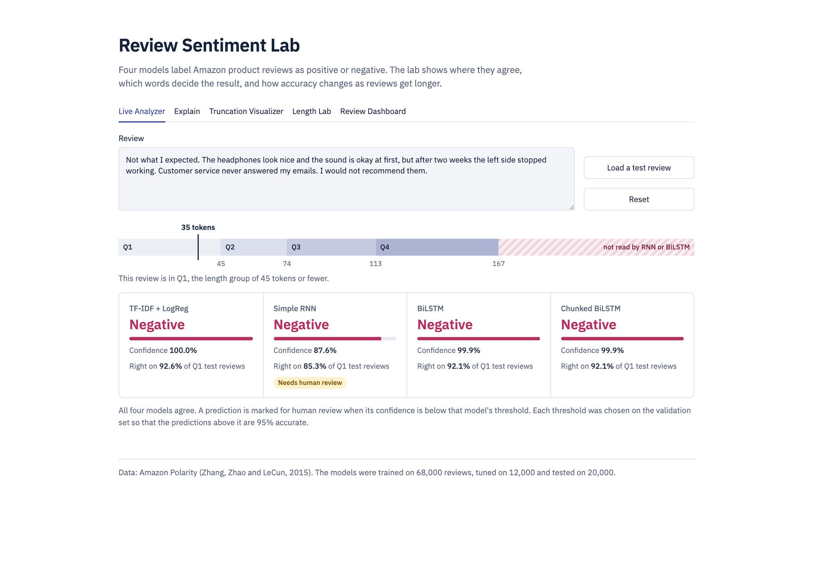
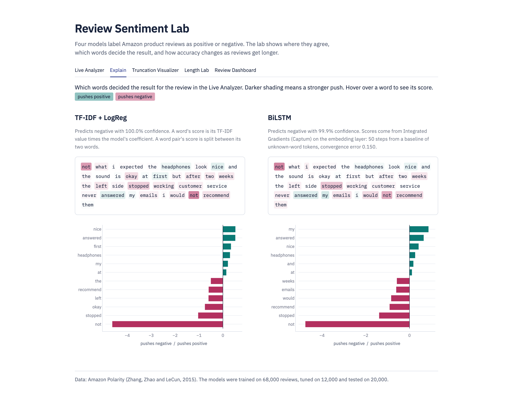
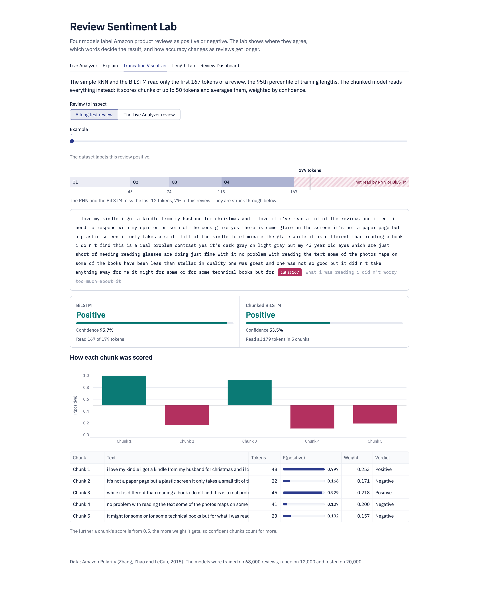
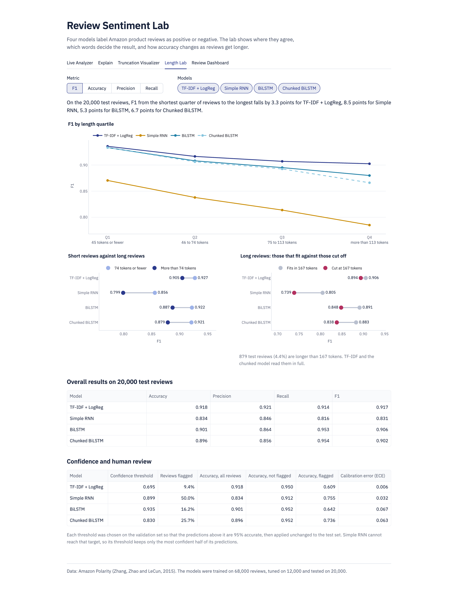
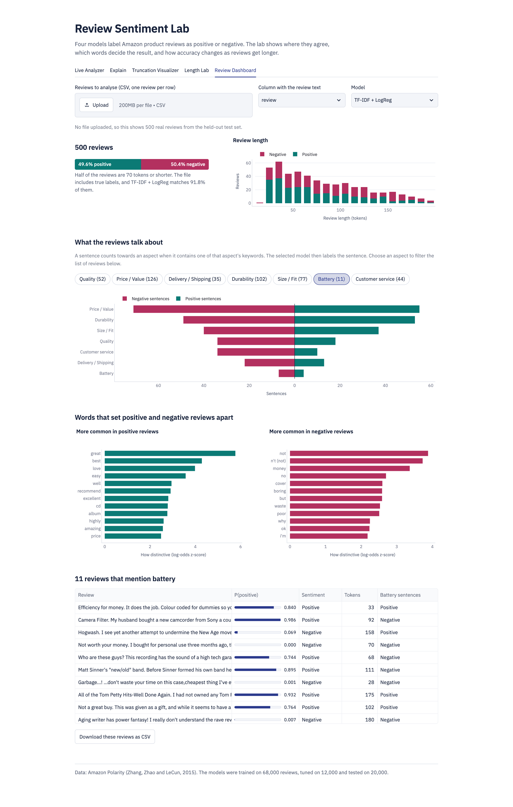

# Review Sentiment Lab — does review length affect sentiment classification?

An NLP project that classifies Amazon product reviews as **positive** or **negative** and measures how
**review length** affects accuracy. Four models are trained and tested on exactly the same splits:

| key | model |
|---|---|
| `tfidf_lr` | TF-IDF (unigrams + bigrams) + Logistic Regression |
| `rnn` | Simple (Elman) RNN with a trainable embedding layer |
| `lstm` | Bidirectional LSTM with a trainable embedding layer (final states + max-pooling) |
| `chunked_lstm` | The trained BiLSTM applied to ≤50-token sentence chunks, combined by confidence-weighted averaging |

It also ships a 5-tab **Streamlit app**, a **FastAPI** service, calibration / human-review flagging and an
error analysis. Every number below was produced by the code in this repository on the real data —
nothing is hand-written or synthetic.

---

## 1. Setup

Tested on a MacBook Air (Apple Silicon, macOS), Python 3.11, PyTorch 2.15 using the `mps` GPU device
(falls back to CPU automatically).

```bash
cd "Senti Kirtan"
python3.11 -m venv .venv
source .venv/bin/activate
pip install -r requirements.txt
```

Data (already in place, nothing else is downloaded):
`data/raw/train-00000-of-00004.parquet` and `data/raw/test-00000-of-00001.parquet` from Hugging Face
[`fancyzhx/amazon_polarity`](https://huggingface.co/datasets/fancyzhx/amazon_polarity) (Zhang et al., 2015).
Columns: `label` (0 = negative, 1 = positive), `title`, `content`.

## 2. How to run

```bash
python main.py                    # full pipeline: data → 3 trainings → chunked → evaluation → calibration → errors (~25 min)
python main.py --skip-training    # re-use saved models/, only re-score and re-evaluate (~1 min)
python main.py --stages evaluate calibration   # any subset of stages
```

Stages can also be run one by one: `python -m src.data_prep`, `python -m src.train_baseline`,
`python -m src.train_nn rnn`, `python -m src.train_nn lstm`, `python -m src.chunked`, `python -m src.evaluate`,
`python -m src.calibration`, `python -m src.error_analysis`.

**App**

```bash
streamlit run app/streamlit_app.py
```

**API**

```bash
uvicorn api.main:app --port 8000
curl -X POST localhost:8000/predict -H "Content-Type: application/json" \
     -d '{"text": "Terrible quality, it broke after a week. Do not buy!", "model": "lstm", "top_k": 4}'
```

returns `label`, `confidence`, `prob_positive`, `needs_human_review`, `token_count`, `truncated` and
`top_words` (Integrated Gradients for the RNN/BiLSTM, TF-IDF × coefficient for the logistic regression).
Interactive docs at `http://localhost:8000/docs`.

**Notebook**: `notebooks/sentiment_project.ipynb` walks through the whole pipeline with outputs (already
executed). It re-runs data prep, the chunked model, evaluation, calibration and error analysis, and loads
the trained checkpoints (set `RETRAIN = True` in the first cell to retrain inside the notebook).
To re-execute: `python -m ipykernel install --user --name senti-kirtan` then
`jupyter nbconvert --to notebook --execute --inplace notebooks/sentiment_project.ipynb`.
`notebooks/build_notebook.py` regenerates the notebook from source.

## 3. Project structure

```
├── main.py                      # runs every stage in order
├── requirements.txt             # pinned versions
├── src/
│   ├── config.py                # paths, sample sizes, hyper-parameters, seeds, device
│   ├── text_utils.py            # cleaning, tokenisation, sentence/chunk splitting
│   ├── data_prep.py             # stage 1+2: sampling, cleaning, stats, length groups
│   ├── vocab.py                 # train-only vocabulary (top 20k + <PAD>, <OOV>)
│   ├── models.py                # Simple RNN and BiLSTM (PyTorch)
│   ├── train_baseline.py        # TF-IDF + Logistic Regression
│   ├── train_nn.py              # RNN / BiLSTM training with early stopping
│   ├── chunked.py               # chunked BiLSTM (+ hybrid variant)
│   ├── evaluate.py              # metrics overall / per length group, plots
│   ├── calibration.py           # reliability diagrams, human-review flagging
│   ├── error_analysis.py        # 20 misclassified reviews per model with cause tags
│   └── inference.py             # shared loader/predictor for app + API (Captum IG lives here)
├── app/streamlit_app.py         # 5-tab Streamlit app;  app/aspects.py: aspect keywords + n-grams
├── .streamlit/config.toml       # app theme (colours, fonts)
├── api/main.py                  # FastAPI service
├── notebooks/                   # sentiment_project.ipynb (+ build_notebook.py)
├── data/raw | processed | demo  # parquet inputs, processed CSVs, 500-review demo CSV (real test reviews)
├── models/                      # tfidf_lr.joblib, rnn_best.pt, lstm_best.pt, vocab.json
├── results/
│   ├── tables/*.csv             # every metrics table
│   ├── figures/*.png            # every plot
│   ├── predictions/*.csv        # per-model val/test probabilities
│   └── length_thresholds.json, flag_thresholds.json, *.log
└── docs/screenshots/            # app screenshots (docs/take_screenshots.py regenerates them)
```

## 4. Method

**Data preparation** (`src/data_prep.py`)
- `text = title + ". " + content`; empty rows and exact duplicates removed (13 duplicates in the train file,
  1 in the test file); 3 test reviews whose text also appears in the train file were removed (leakage guard).
- Balanced random sample (seed 42): **80,000** reviews from the train file → stratified **85/15** split =
  **68,000 train / 12,000 validation**; **20,000** reviews from the test file = held-out **test**. Each split is exactly 50/50.
- Cleaning: lower-case, strip HTML tags/entities and URLs, normalise whitespace. Stop-words are **not**
  removed, so negations survive; contractions are split (`don't` → `do n't`) so `n't` is its own token;
  `!` and `?` are kept as tokens; other punctuation is dropped from the token stream.
- The pipeline is deterministic — re-running it reproduces byte-identical CSVs (checked with md5).

**Dataset statistics** (`results/tables/dataset_stats.csv`, `results/figures/length_histogram.png`)

| split | n | mean tokens | median | p5 | p25 | p75 | p95 | p99 | max |
|---|---|---|---|---|---|---|---|---|---|
| train | 68,000 | 82.5 | 74 | 25 | 45 | 113 | 167 | 187 | 253 |
| val | 12,000 | 81.9 | 73 | 26 | 45 | 113 | 165 | 187 | 218 |
| test | 20,000 | 80.6 | 71 | 25 | 44 | 112 | 165 | 186 | 225 |

Label vs length: negative reviews are slightly longer (train mean 85.8 vs 79.3 tokens; point-biserial
r = −0.072, p ≈ 1e-79). Length alone is a very weak signal, but it means class balance shifts across length groups.

**Length groups** — thresholds computed on **train only** (`results/length_thresholds.json`):
two-way **short ≤ 74 < long**, quartiles **Q1 ≤ 45 < Q2 ≤ 74 < Q3 ≤ 113 < Q4**.
`max_len` for the neural models = 95th percentile of train token counts = **167**.

Class balance inside each test group (`results/tables/length_group_stats.csv`):

| test group | n | % positive | reviews longer than max_len |
|---|---|---|---|
| short | 10,509 | 52.9 % | 0 |
| long | 9,491 | 46.7 % | 879 (9.3 %) |
| Q1 | 5,322 | 57.6 % | 0 |
| Q2 | 5,187 | 48.1 % | 0 |
| Q3 | 4,679 | 46.5 % | 0 |
| Q4 | 4,812 | 47.0 % | 879 (18.3 %) |

Truncation is therefore confined to Q4: **879 of 20,000 test reviews (4.4 %)** are truncated, losing on
average 12.7 tokens (median 11, max 58), i.e. ~6.9 % of their text. (Amazon Polarity reviews are capped at
about 1,000 characters, so the longest review here is 253 tokens.)

**Models**
- *TF-IDF + LR*: uni+bigrams, `min_df=2`, 200k features, sublinear TF; `C` chosen on validation log-loss
  from {0.5 … 64} → **C = 16** (val log-loss 0.2084, val acc 0.9183). Fit on train only.
- *Neural models*: vocabulary = top 20,000 train tokens + `<PAD>`, `<OOV>`; head truncation at 167 tokens;
  embedding 128, hidden 128, dropout 0.5, AdamW (lr 1e-3, weight decay 1e-4), LR halved on plateau, gradient
  clipping 1.0, batch 128, packed sequences (padding never enters the recurrence), early stopping on validation
  loss (patience 3, max 20 epochs); the best checkpoint is saved to `models/`.
  - Simple RNN: 1-layer unidirectional tanh RNN, last hidden state → linear.
  - BiLSTM: 1-layer bidirectional LSTM, [last forward state, last backward state, max-pool over time] → linear.

| model | best epoch | val loss | val acc | params | training time (MPS) |
|---|---|---|---|---|---|
| Simple RNN | 7 | 0.413 | 0.836 | 2.59 M | 3.5 min (10 epochs) |
| BiLSTM | 6 | 0.301 | 0.902 | 2.82 M | 13.6 min (9 epochs) |

Training curves: `results/figures/training_curves_rnn.png`, `training_curves_lstm.png`.
Both models stayed well under the ~20 min/model budget, so **no reduction of epochs or sample size was needed**.

- *Chunked BiLSTM*: each review is split into sentences, consecutive sentences are merged into
  chunks of ≤ 50 tokens (longer sentences are cut into 50-token windows), the trained BiLSTM scores each chunk
  and scores are combined as `p = Σ wᵢ pᵢ / Σ wᵢ` with `wᵢ = |2pᵢ − 1|` (confidence weighting). On the test
  set this gives 2.35 chunks per review on average (max 7). A *hybrid* variant (chunk only reviews longer
  than 167 tokens) is also reported.

## 5. Results (held-out test set, 20,000 reviews)

### Overall (`results/tables/metrics_overall.csv`, `results/figures/confusion_matrices.png`)

| model | accuracy | precision | recall | F1 |
|---|---|---|---|---|
| **TF-IDF + LogReg** | **0.9176** | **0.9206** | 0.9140 | **0.9173** |
| Simple RNN | 0.8340 | 0.8462 | 0.8163 | 0.8310 |
| BiLSTM | 0.9015 | 0.8639 | 0.9532 | 0.9063 |
| Chunked BiLSTM | 0.8964 | 0.8556 | **0.9537** | 0.9020 |

The TF-IDF baseline is the best model on this 68k-review training set. The BiLSTM is 1.6 accuracy points
behind and is biased towards *positive* (recall 0.953 vs precision 0.864). The simple RNN is clearly weakest.

### By length (`results/tables/metrics_by_length_group.csv`, `results/figures/f1_by_quartile.png`)

F1 per length quartile:

| model | Q1 (≤45) | Q2 (46–74) | Q3 (75–113) | Q4 (>113) | Q1 → Q4 |
|---|---|---|---|---|---|
| TF-IDF + LogReg | 0.9359 | 0.9165 | 0.9071 | 0.9025 | −3.3 pts |
| Simple RNN | 0.8705 | 0.8379 | 0.8138 | 0.7850 | −8.5 pts |
| BiLSTM | 0.9334 | 0.9081 | 0.8951 | 0.8800 | −5.3 pts |
| Chunked BiLSTM | 0.9334 | 0.9063 | 0.8926 | 0.8661 | −6.7 pts |

Accuracy per quartile shows the same monotone decline (TF-IDF 0.926 → 0.909, RNN 0.853 → 0.806,
BiLSTM 0.921 → 0.879, chunked 0.921 → 0.862; `results/figures/accuracy_by_quartile.png`).

Short vs long (`results/tables/short_long_gap.csv`):

| model | acc short | acc long | gap (pts) | F1 short | F1 long | gap (pts) |
|---|---|---|---|---|---|---|
| TF-IDF + LogReg | 0.9229 | 0.9117 | 1.12 | 0.9272 | 0.9048 | 2.24 |
| Simple RNN | 0.8486 | 0.8177 | 3.09 | 0.8557 | 0.7993 | 5.65 |
| BiLSTM | 0.9142 | 0.8875 | 2.67 | 0.9219 | 0.8874 | 3.46 |
| Chunked BiLSTM | 0.9132 | 0.8777 | 3.55 | 0.9211 | 0.8789 | 4.22 |

**Findings on length**
1. **Every model gets worse as reviews get longer**, in both accuracy and F1. Short reviews (often a
   title plus one or two blunt sentences) are easier; long reviews more often mix praise and criticism.
2. **Sequence models are much more length-sensitive than the bag-of-n-grams model**: the RNN loses
   8.5 F1 points from Q1 to Q4 and the BiLSTM 5.3, vs 3.3 for TF-IDF+LR. The vanilla RNN's degradation is
   consistent with its known difficulty carrying information over long sequences.
3. Part of the F1 drop is a class-balance effect (Q1 is 57.6 % positive, Q2–Q4 ≈ 47 %, and F1 is computed on
   the positive class), but accuracy, which is not affected by that, declines too.
4. **Truncation matters but is small in scope** (`results/tables/truncation_effect.csv`). Among long reviews,
   the 879 truncated ones are classified worse by every model — BiLSTM 0.849 vs 0.891 on long reviews that fit,
   RNN 0.777 vs 0.822 — but TF-IDF+LR, which sees the full text, also drops (0.904 vs 0.912). So the
   very longest reviews are intrinsically harder, and truncation adds a further penalty for the
   sequence models (BiLSTM: −4.3 pts vs −0.8 for TF-IDF). Because only 4.4 % of test reviews are truncated, this
   explains only a small part of the overall short-vs-long gap.

### Does chunking close the gap? No.

`results/tables/chunked_variants_comparison.csv`:

| variant | overall acc | short acc | long acc | Q4 acc | truncated reviews acc |
|---|---|---|---|---|---|
| BiLSTM (truncate at 167) | 0.9015 | 0.9142 | 0.8875 | 0.8791 | 0.8487 |
| Chunked BiLSTM (all reviews) | 0.8964 | 0.9132 | 0.8777 | 0.8624 | 0.8339 |
| Hybrid (chunk only if > 167 tokens) | 0.9009 | 0.9142 | 0.8861 | 0.8764 | 0.8339 |

The chunked model **widens** the short-vs-long accuracy gap (3.55 pts vs 2.67) and is worse even on the
truncated reviews it was designed for (0.834 vs 0.849). The hybrid variant is also slightly worse than plain
truncation. Likely reasons, from inspecting chunk verdicts in the app's Truncation Visualizer:
(a) truncation only hides ~13 tokens on average here, so there is little to recover; (b) the BiLSTM was trained
on whole reviews, and isolated 50-token fragments lose the context (e.g. a positive opening followed by
"but…"); (c) confidence weighting lets one confidently-wrong chunk dominate. A model trained on chunks, or
a learned aggregator, would be needed to make chunking pay off.

### Calibration and human-review flagging

`results/tables/calibration_summary.csv`, `results/figures/reliability_diagrams.png`:

| model | ECE | Brier |
|---|---|---|
| TF-IDF + LogReg | 0.0057 | 0.0614 |
| Simple RNN | 0.0317 | 0.1277 |
| BiLSTM | 0.0671 | 0.0786 |
| Chunked BiLSTM | 0.0632 | 0.0824 |

The logistic regression is almost perfectly calibrated. The BiLSTM is not: in the middle bins it predicts
P(positive) much higher than the observed positive rate (the same positive bias seen in its precision/recall).

Flagging rule: confidence = max(p, 1 − p); on the **validation** set we pick the smallest threshold whose
auto-accepted predictions reach **95 % accuracy** (keeping at least 50 % of reviews). The threshold is then
applied unchanged to the test set (`results/tables/human_review_flagging.csv`, `results/figures/coverage_vs_accuracy.png`):

| model | threshold (val) | test % flagged | test acc, all | test acc, not flagged | gain |
|---|---|---|---|---|---|
| TF-IDF + LogReg | 0.695 | 9.4 % | 0.9176 | 0.9497 | +3.2 pts |
| Simple RNN | 0.899* | 50.0 % | 0.8340 | 0.9125 | +7.9 pts |
| BiLSTM | 0.935 | 16.2 % | 0.9015 | 0.9516 | +5.0 pts |
| Chunked BiLSTM | 0.830 | 25.7 % | 0.8964 | 0.9518 | +5.5 pts |

\*The RNN cannot reach 95 % on validation while keeping half the reviews; its threshold keeps the most
confident 50 % (reported as `target_reached_on_val = False`).
Flagged predictions are indeed the unreliable ones (accuracy on flagged reviews: 0.61 TF-IDF, 0.64 BiLSTM).
Long reviews are flagged slightly more often (TF-IDF 9.9 % vs 9.0 % short; BiLSTM 17.4 % vs 15.1 %; chunked 38.2 % vs 14.4 %).
Sending ~9 % of reviews to a human lifts the TF-IDF model's accuracy on the rest from 91.8 % to 95.0 %.

### Error analysis

`results/tables/error_analysis_misclassified.csv` holds 20 misclassified test reviews per model (5 per length
quartile, seeded random sample) with their length group and a **heuristic** likely-cause tag
(truncation / negation / mixed sentiment / sarcasm / other — rules documented in `src/error_analysis.py`;
these are indicators, not human annotations). Tag counts (`error_analysis_cause_counts.csv`, a review can have several):

| model | truncation | negation | mixed sentiment | sarcasm | other |
|---|---|---|---|---|---|
| TF-IDF + LogReg | 0 | 5 | 15 | 4 | 4 |
| Simple RNN | 1 | 2 | 11 | 2 | 7 |
| BiLSTM | 2 | 3 | 15 | 4 | 4 |
| Chunked BiLSTM | 0 | 2 | 13 | 2 | 5 |

Mixed sentiment (praise plus a decisive complaint, or a "but…" pivot) is by far the most common pattern.
Typical examples from the file: a negative review that is sarcastic about a song copying another
("I liked this song back when it was called …"), negations such as "the story is not what I like", and
reviews that are not in English or that mostly discuss another product/the movie version — the latter are
tagged *other*.

## 6. Streamlit app

```bash
streamlit run app/streamlit_app.py
```

| Tab | What it does |
|---|---|
| **Live Analyzer** | Type a review or load a random real test review. A length ruler shows where the review falls among the four length quartiles and the 167-token limit. Each of the 4 models gives its label and confidence, its test accuracy on reviews of that length, and a *Needs human review* mark when confidence is below the validation-chosen threshold. |
| **Explain** | Side-by-side word highlighting and the strongest words for TF-IDF × LR coefficients and for Captum **Layer Integrated Gradients** on the BiLSTM (all-`<OOV>` baseline of the same length, 50 steps; convergence error shown). |
| **Truncation Visualizer** | Long test reviews (or your text): tokens after `max_len` are struck through; the chunked model's per-chunk scores, weights and combined result are shown next to the plain BiLSTM. |
| **Length Lab** | Interactive charts of F1 / accuracy / precision / recall by quartile, short against long reviews, truncated against fitting reviews, plus the overall and calibration/flagging tables. Everything is loaded from `results/tables/*.csv`. |
| **Review Dashboard** | Upload a CSV (default: 500 real test reviews in `data/demo/demo_reviews.csv`): sentiment split, length distribution, aspect chips (quality, price/value, delivery/shipping, durability, size/fit, battery, customer service) with sentence-level positive/negative counts that filter the review list, most distinctive positive/negative n-grams (log-odds), CSV download. |







Screenshots are regenerated with `python docs/take_screenshots.py` while the app is running
(needs `pip install -r requirements-dev.txt` and Google Chrome; no browser download).

## 7. Reproducibility notes and limitations

- All seeds (Python, NumPy, PyTorch, MPS, sklearn, pandas sampling) are fixed to 42 and the data pipeline is
  bit-for-bit reproducible. **GPU (MPS) training is not bit-for-bit deterministic**: re-running the RNN
  with identical settings gave slightly different curves (e.g. best val acc 0.840 vs 0.836). Expect small
  variations in neural-model numbers if you retrain; the numbers above come from the checkpoints in `models/`.
- Development history, stated for transparency: a first BiLSTM (final states only, Adam, dropout 0.4, patience 2)
  early-stopped after 1 epoch at 0.862 val acc; it was replaced by the configuration above (max-pooling,
  AdamW, LR-on-plateau, dropout 0.5, patience 3), and both neural models were retrained with that shared
  configuration. The RNN was then retrained once more with the epoch cap raised from 10 to 20 because it had
  hit the cap before early stopping triggered (the BiLSTM early-stopped at epoch 9 and was unaffected).
  `C` for the logistic regression was selected on validation only. The test set was not used for any choice.
- The models are trained on 68k reviews (a ~2 % sample of Amazon Polarity) with embeddings learned from
  scratch; with more data or pre-trained embeddings/transformers the neural models would likely overtake the
  TF-IDF baseline. The BiLSTM's positive bias could be reduced by tuning its decision threshold on validation.
- Amazon Polarity reviews are short (≤ 253 tokens here), so "long" means 75–253 tokens, and truncation
  at the 95th percentile affects only 4.4 % of reviews.
- Error-cause tags and aspect detection are keyword heuristics.
- The FastAPI service and the Streamlit app run inference on CPU.

## Reference

Xiang Zhang, Junbo Zhao, Yann LeCun. *Character-level Convolutional Networks for Text Classification.* NeurIPS 2015.
